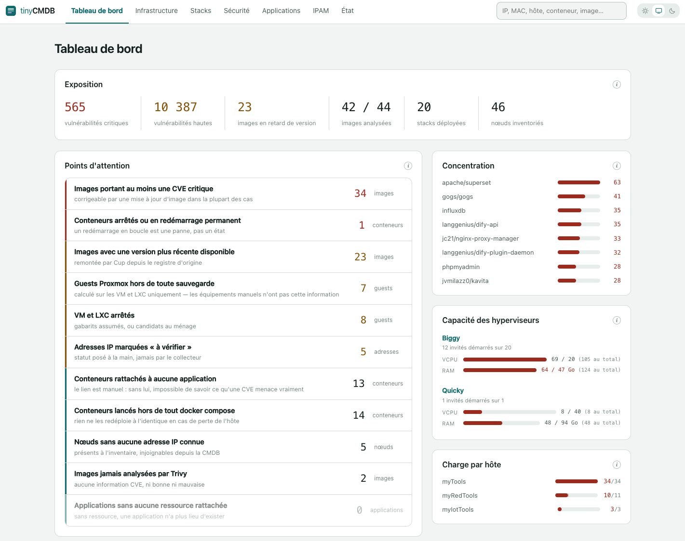
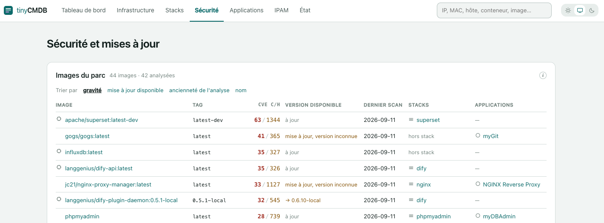
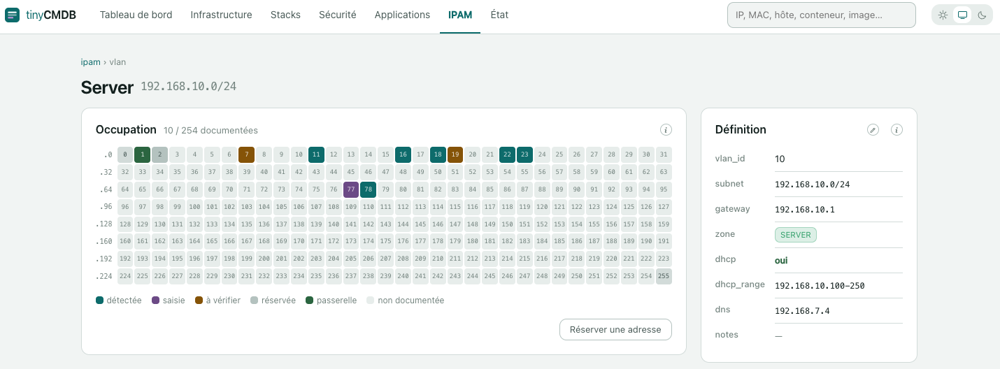
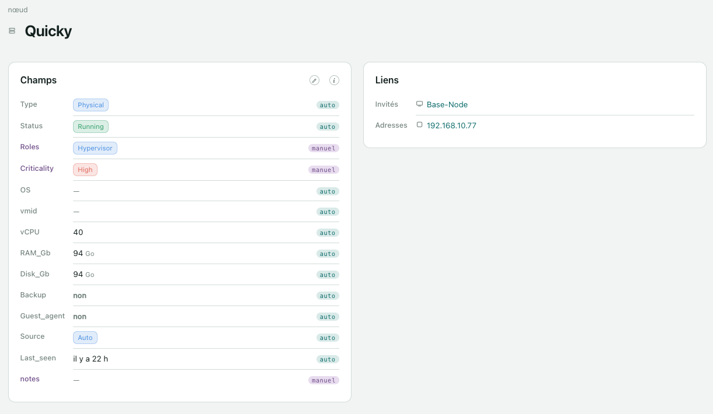
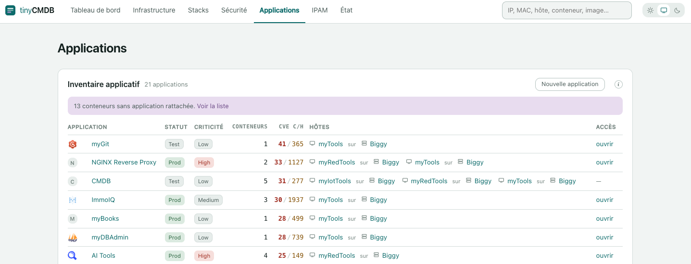

# TinyCMDB

**A homelab inventory, and nothing more.** A collector that discovers Proxmox
and Docker, scans images for vulnerabilities and pending updates, and a web
console that tells you, field by field, what it wrote and what you typed.

*Code comments and interface are in French.*

<br clear="left">

---

A homelab CMDB always decays the same way: you type something useful into it, a
script overwrites it on the next pass, you never notice, and you stop trusting
it. TinyCMDB solves one problem, but completely: **knowing, field by field, who
owns what** — and never letting you type into a field whose disappearance is
already scheduled.

Everything else follows. A collector that only touches what it owns. A console
that only opens for editing what will survive. A database that reflects what is
in place rather than a history of what used to be.



### What it does

- **Discovers** Proxmox nodes (hypervisors, VMs, LXC containers) and the
  containers on each Docker host, through a read-only socket proxy.
- **Describes the hardware**: CPU model, cores, x86-64 level and architecture of
  each hypervisor; its PCIe cards, disks (SMART health, wear) and USB devices,
  with the IOMMU group and the VM each one is passed through to; the full Proxmox
  configuration of every guest. A CPU model's specifications live once in a
  reference table, shared by every machine that carries it. What no API can see
  (motherboard, BIOS, memory type and ECC) is entered by hand — and the rest of
  the estate, outside Proxmox, too.
- **Scans** images with [Trivy](https://github.com/aquasecurity/trivy) (CVEs)
  and [Cup](https://github.com/sergi0g/cup) (available updates).
- **Keeps an IPAM** per VLAN, with an occupancy grid of the /24 where a free
  cell is a link to reserving that very address.
- **Connects it all**: hypervisor → guest → container → image → CVE, with IP
  addresses cutting across — which turns "this image carries 41 critical
  vulnerabilities" into "*this* service is affected".
- **Deletes** what has disappeared, after a grace period, and shows it coming.
- **Answers other tools and agents**, through a REST API and an MCP server, each
  behind per-application tokens — so that whatever acts on the estate reads what
  the inventory knows without going behind it.
- **Stands alone**: one SQLite file, backed up by the application itself into a
  directory the host can see. No external database, no other service.

### What it isn't

**It observes; it does not act.** Nothing here can restart, redeploy or alter
the estate it describes: no Docker socket, no Portainer key, no credential that
grants more than reading on Proxmox or on a host. The only thing it writes to is
its own database. An inventory able to change what it describes is no longer an
inventory, and a leak of it stops being a leak of information — it becomes a way
in. Tools that act read this one through its API; a weekly updater lives outside
this repository for exactly that reason.

This is not NetBox, GLPI or i-doit. No asset lifecycle management, no ticketing,
no approval workflow, no multi-tenancy, no snapshots of the estate — the journal
says who wrote what and which field changed when, the question a debugging
session starts with, not what the whole infrastructure looked like on a given
day. No purchase dates or warranties either: fields of your own can carry them,
the core does not. The project
targets a few hundred rows — an estate one person can hold in their head — and
that ceiling is not a limitation to work around, it is the goal: have what you
need and no more. If the inventory grows heavy, the thing to look at is the
infrastructure, not the code.

## Why SQLite — and why no longer Baserow

Up to 0.3, TinyCMDB stored its rows in [Baserow](https://baserow.io/). The
reasoning was sound at the time: storage is the easy part, and Baserow brought
everything *around* the rows — a schema you change without a migration, select
options added without a deploy, and a working door to your data when the console
did not cover a case.

Then the console grew to cover every case, and the door stopped being used. What
remained was the cost: a Django, a Postgres and a Redis running for a few hundred
rows; an API with no joins, so the whole graph was rebuilt from six HTTP calls —
a quarter of a second per reload; and a database token that could be scoped
neither by origin, nor by row, nor by application.

0.4 moves the three things Baserow provided into the console itself, then drops
it:

- **Select options** are edited in *Administration → Lists*: add, rename,
  recolour, reorder, delete — a deletion offers to move the rows that used the
  option to another one.
- **Fields of your own** are added in *Administration → Fields*, on any table:
  text, long text, URL, integer, checkbox, date, single or multiple select. They
  appear on the records, in the forms, in the API and in MCP. The fields the code
  relies on are not editable there; they change through a numbered migration
  (`app/cmdb/migrations/`), applied on startup.
- **Bulk work** goes through *Administration → Data*: CSV export of any table,
  and an import that shows exactly what it will create, change and refuse before
  writing anything — through the same rules as the forms.

What SQLite brings in return: reads in milliseconds and real joins; transactions;
two processes writing the same file safely (WAL mode); tokens scoped per
application and per right; and **one directory to back up**. The price is stated
plainly: there is no second door. If the console cannot do something, nothing
else will — which is why it carries its own backups, and why every deletion
lands in full in the journal.

### Requirements

- **Docker** and **Docker Compose**.
- A **local directory** on the host for the database — local disk, never an SMB
  or NFS share: SQLite's locks are not reliable over a network filesystem.
- At least one thing to inventory: a **Proxmox VE** cluster and/or **Docker**
  hosts reachable through a socket proxy.

## Installation

**1. Prepare the sources.** A Proxmox API token created with `--privsep 0`
([details](#proxmox-setup)), and a socket proxy on each Docker host
([details](#docker-setup-socket-proxy)). Either one alone is enough to start.

**2. Clone and configure.**

```bash
git clone https://github.com/morphe777/tinycmdb.git
cd tinycmdb
cp .env.example .env
chmod 600 .env
$EDITOR .env      # TINYCMDB_DATA, PROXMOX_URL and/or DOCKER_HOSTS
```

**3. Prepare the data directory.** Both services mount it on `/data`; it holds
`tinycmdb.db` and `backups/`. It must belong to UID 1000, the user inside the
image — Docker would otherwise create it owned by root, and the console would
say so rather than start writing:

```bash
mkdir -p ./data && sudo chown 1000:1000 ./data     # or the path set in TINYCMDB_DATA
```

**4. Set the published address.** In `compose.yaml`, replace
`192.168.10.11:8080:8080` with your host's own address on your management VLAN.
Never `0.0.0.0`: this console aggregates the entire inventory and has no
business on your other segments.

**5. Start.** Either pull the published image:

```bash
docker compose pull
docker compose up -d
```

or build it yourself from the sources you just cloned — two minutes, and nothing
to trust but your own checkout:

```bash
docker compose up -d --build
```

Then watch the first pass:

```bash
docker compose logs -f collector
```

The database is created and its schema applied on first start, by whichever
service comes up first. The Trivy cache is a named volume — nothing to create,
nothing to `chown`. The first pass takes a few minutes if Trivy has to download
its vulnerability database (~1 GB, kept in that volume afterwards); set
`TRIVY_ENABLED=false` to skip scanning entirely, and the Security screen will
simply have nothing to show. The console is immediately available on port 8080
of the address set in step 4; until the first pass completes, it will honestly
tell you the inventory is empty.

**6. Create tokens** for whatever should talk to the inventory — an application,
an agent — in *Administration → Tokens* (see [API and MCP](#api-and-mcp)).

**To develop without rebuilding on every line**, mount the code over the image:

```bash
cp compose.override.yaml.example compose.override.yaml
docker compose up -d          # ./app is now mounted read-only
docker compose restart web    # after a change
```

That override is git-ignored and has no place on a production host: the point of
an image is that what runs is exactly what was built.

To run a single pass instead of waiting for the loop: set `RUN_ONCE=true` in
`.env`, then `docker compose run --rm collector`.

## Using it

Seven screens and an administration menu, and one idea running through all of
them: what the collector owns is shown, what is yours can be edited.

**Find what needs attention.** The dashboard is not a set of decorative
counters: it is a list of clickable work queues, ordered by what costs the most
if ignored — images carrying critical CVEs, versions behind, containers running
outside any Compose project, containers attached to no application, nodes with
no known IP address. An empty queue is the good news of the day.

**Track vulnerabilities.** *Security* lists every image by severity, with the
version Cup found available and Trivy's CVE counts. The column that matters is
the last one: which applications are affected. An image with critical CVEs and
no application attached is a vulnerability whose business impact cannot be
established — which is a finding in itself.



**Read the infrastructure.** *Infrastructure* separates hypervisors and their
guests from the physical estate. A tick or a cross to the left of each name says
whether it is up; the type and roles are tags on the line.

**Manage addresses.** *IPAM* shows one grid per VLAN, one cell per address of
the /24. Clicking an undocumented cell opens the reservation form with the
address already filled in: give it a MAC, a node, a type, and the row is created
as a manual entry — which the collector will never delete, even though nothing
answers at that address. VLANs themselves are declared from the same screen.



**Correct a field.** Open any record and click the pencil next to the help
button. Only the fields the collector never rewrites are offered. This is
enforced server-side, so the console cannot promise you an edit that would
silently vanish on the next pass.



Teal is what the collector owns, purple is yours. On this hypervisor, the roles,
the criticality and the notes are the only three fields worth typing into — the
other eleven will be rewritten on the next pass, and the console says so rather
than letting you find out.

**Declare an application.** *Applications* → *New application*. An application
is a grouping you decide — it may span several stacks, or a VM with no Docker at
all. Attaching containers to it is what turns "this image carries 41 critical
vulnerabilities" into "*this* service is affected".



**Check the plumbing.** *Status* shows each component of the CMDB itself — the
collector, the database, the last backup — and, more usefully, the rows on
borrowed time: what the collector no longer sees and will actually delete, with
the remaining delay.

## Administration

Everything that used to be done in Baserow, plus what a standalone application
needs to look after itself. The menu is open like the rest of the console: if
it must be restricted, the reverse proxy in front is the place (by source
address, for instance).

| Screen | What it does |
|---|---|
| **Lists** | The options of every single and multiple select, per table: add, rename, recolour, reorder, delete with reassignment. The values the collector writes or relies on (`Source = Auto / Manual`, the Docker and Proxmox statuses, `Node.Type` Physical / VM / LXC, the `Hypervisor` and `Docker` roles…) can be recoloured but not renamed or deleted — the list is `OPTIONS_PROTEGEES` in `app/cmdb/modele.py`. |
| **Fields** | Fields of your own on any table, with a help text shown on the records. Deleting one deletes its values, after confirmation. |
| **Data** | CSV export (`;`-separated, UTF-8 with BOM — opens as-is in a spreadsheet) and import with a preview: each line is shown as a creation, a change or a refusal with its reason, and nothing is written until you confirm. The rows match on `id`, or on the natural key when `id` is empty. |
| **Journal** | Every write — console, API, MCP — with its author, the field, the value before and after; and what the collector observes: creations, deletions, and every field that changes between two passes (a container gone to `Exited`, a new image digest, a VM given more memory, an edited Proxmox configuration, a disk whose SMART health drops). `Last_seen` and CVE counters are left out: they change on every pass. A deleted row is kept in full, so it can be retyped. Kept 365 days by default. |
| **Backups** | The copies, a *back up now* button, download, and the settings: interval (24 h), how many copies to keep (14), journal retention. |
| **Tokens** | API and MCP tokens — see below. |

Deleting a row is done from its record, behind a confirmation box, and on every
table: the collector would delete a vanished container after the grace period
anyway; the console lets you do it now. Nodes and addresses also carry a
*provenance* switch: setting `Source = Manual` takes the row out of the
collector's hands, setting it back to `Auto` returns it.

## Backups and restore

The collector writes a consistent copy of the database every 24 hours
(`VACUUM INTO`, safe while both services are writing), checks it with
`PRAGMA integrity_check`, and keeps the last 14:

```
${TINYCMDB_DATA}/
  tinycmdb.db              the database (plus -wal / -shm while it runs)
  backups/
    tinycmdb-2026-11-11_072339.db
    …
```

Back up that directory from the host with the rest of your files. The copies in
`backups/` are what you want to restore from: unlike the live file, each one is
self-contained and never caught mid-write.

To restore:

```bash
docker compose stop
cd "$TINYCMDB_DATA"
cp tinycmdb.db tinycmdb.db.before-restore            # in case
cp backups/tinycmdb-2026-11-11_072339.db tinycmdb.db
rm -f tinycmdb.db-wal tinycmdb.db-shm                # belong to the file just replaced
docker compose start
```

Removing the `-wal` and `-shm` files is not optional: SQLite would otherwise try
to apply the previous file's pending writes to the restored one.

A copy downloaded from *Administration → Backups* is a regular SQLite file:
any SQLite tool reads it, which is also how to inspect the data outside the
console without touching the live database.

## API and MCP

Every application of the homelab, and every agent, talks to the inventory
through one of two doors, both on the console's port:

| | Address | For |
|---|---|---|
| REST API | `/api/v1/` — interactive documentation at `/api/v1/docs` | applications, scripts |
| MCP server | `/mcp` (streamable HTTP, stateless) | AI agents |

Both require `Authorization: Bearer <token>`. Tokens are created in
*Administration → Tokens*, one per consumer: it is revoked on its own, and the
journal attributes each write to its name (`api:homepage`, `mcp:agent-ops`). A
token is shown once at creation — only its SHA-256 is stored — and can carry an
expiry date.

- A **read** token reads everything: objects with their fields, the provenance
  of each field and resolved links, search, stacks, work queues, rows on
  borrowed time, health, journal, schema.
- A **write** token can also change manual fields, create nodes, addresses,
  VLANs, applications, CPU models and components, and attach applications to a
  stack — through exactly the same code as the console's forms, hence the same
  refusals, with the same explanations. **No token deletes.**

Built for an agent that helps design, choose and debug, four reads matter most:

| | REST | MCP |
|---|---|---|
| An object and its whole neighbourhood in one call — host, CPU and its specs, components, guests, containers, applications | `GET /api/v1/contexte/{type}/{id}` | `contexte` |
| Structured queries — `{"Arch": "arm64"}`, `{"Category": "Disk", "Wearout": ">=50"}`, `{"BIOS": null}` | `GET /api/v1/{type}?filtres=…&champs=…&vides=false` | `lister(filtres=…)` |
| Room left on each hypervisor — physical cores, vCPU per core, memory promised and free, passed-through devices | `GET /api/v1/capacite` | `capacite` |
| What changed since a date — including what the collector observed | `GET /api/v1/journal?depuis=2026-11-17` | `journal(depuis=…)` |

```bash
curl -H "Authorization: Bearer tcmdb_…" https://cmdb.example/api/v1/noeud?q=pve
claude mcp add --transport http tinycmdb https://cmdb.example/mcp \
  --header "Authorization: Bearer tcmdb_…"
```

The MCP server ships its own usage guide (`app/web/guide_mcp.md`), returned by
its `guide` tool and served at `GET /api/v1/guide`: the model, what provenance
means, which fields an agent may change and why the others are refused. An
agent that reads it first stops trying to fix what the collector will rewrite.

If the reverse proxy filters the console by source address, it can open `/api/`
and `/mcp` more widely: both refuse any request without a valid token.

**It returns facts, not decisions.** "Is this stack eligible for an automatic
update" is not asked here: that is a policy, and it belongs to whoever updates.
The CMDB says what is; the other tool decides what to do about it. That is what
lets the two exist apart — and it is why nothing in this repository holds a
Portainer key.

`GET /api/stacks`, the route of 0.2–0.3, still answers with the same JSON, but
now requires a token like everything else.

## The published image

`ghcr.io/morphe777/tinycmdb`, built by GitHub Actions from a version tag —
`linux/amd64` and `linux/arm64`, so a Raspberry Pi is a valid host. Also mirrored
to Docker Hub.

```
ghcr.io/morphe777/tinycmdb:0.4.0     a given version
ghcr.io/morphe777/tinycmdb:0.4       the latest patch of that minor
ghcr.io/morphe777/tinycmdb:latest    the most recent release
```

Pin a version in `compose.yaml` rather than tracking `latest`: this thing writes
to your inventory, and an unexpected change of behaviour is better discovered on
the day you chose to upgrade. A new version may carry a schema migration; it is
applied on startup, and the backup of the previous night is the way back.

One image, two services — the collector and the console share the same code and
the same dependencies, only the command differs. Building two would cost twice
the build time and create the possibility that they drift apart.

## Deploying with Portainer

`compose.portainer.yaml` is a stack ready to paste into *Stacks → Add stack →
Web editor*. It differs from `compose.yaml` in three ways, and those three are
the whole reason it exists as a separate file:

- **No build.** Portainer has no copy of the repository, so `build:` would have
  no context. The published image is pulled as-is.
- **No `env_file`.** There is no `.env` beside a stack typed into a browser.
  Variables are declared in the file and their values come from Portainer's
  *Environment variables* panel — which keeps your tokens out of the YAML, and
  therefore out of sight of anyone reading the stack.
- **An absolute path** for the data directory. "Next to the stack" means nothing
  when the stack is a form field.

Define at least `TINYCMDB_DATA` — an absolute path on the host, owned by UID
1000, on local disk — and something to collect from: `PROXMOX_URL` +
`PROXMOX_TOKEN`, or `DOCKER_HOSTS`, or both. Everything else has a working
default. Set `WEB_BIND_IP` to your host's address on your management VLAN; left
alone, the console is reachable from the host only, which is the safe default
but probably not what you want.

The file uses a YAML anchor to avoid declaring the same twenty-odd variables
twice. Docker Compose v2 handles it natively; Portainer 1.x would not, but
neither would it run any of this.

## Migrating from Baserow (0.3 → 0.4)

A one-time command copies the six tables into SQLite **with their row ids** —
so `/noeud/12` still points at the same node and bookmarks keep working — along
with every select option, used or not, with its colour and order. It then
rebuilds the console's graph twice, from Baserow and from SQLite, and compares
every object, every field and every link: the command fails on the smallest
difference, and the switch only happens on a migration proven identical.

1. **Stop the 0.3 collector**, so that nothing changes in Baserow meanwhile.
   Leave Baserow itself running.
2. **Prepare the data directory** (step 3 of [Installation](#installation)).
3. **Run the migration** with the old Baserow variables (`BASEROW_URL`,
   `BASEROW_TOKEN`, `BASEROW_VERIFY_TLS`, the six `TABLE_*` — see the end of
   `.env.example`):

   ```bash
   docker run --rm --env-file baserow.env -v /path/to/data:/data \
     ghcr.io/morphe777/tinycmdb:0.4.0 python -m cmdb.reprise_baserow
   ```

   With `compose.yaml`, put those variables in `.env` and run
   `docker compose run --rm --no-deps web python -m cmdb.reprise_baserow` —
   `--no-deps`, or Compose starts the collector first.

   It ends with `Vérification réussie` and exit code 0, or lists the differences
   and exits with 1. `--verifier` compares again without writing; `--remplacer`
   overwrites a database that already holds an inventory.
4. **Start 0.4** (`docker compose up -d`, or update the Portainer stack), then
   remove the Baserow variables.
5. **Create a token** for anything that read `/api/stacks`, and give it the
   header.
6. Keep Baserow, untouched, for a couple of weeks — then drop it.

Not migrated: Baserow's lookup and count fields, which the console computes
itself, and `Application.Source`, which nothing used.

## Local development (without Docker)

```bash
python3 -m venv .venv
source .venv/bin/activate
pip install -r requirements.txt
export $(grep -v '^#' .env | xargs)  # or source a separate file
export TINYCMDB_DB=$PWD/data/tinycmdb.db
cd app && python -m collector.main
```

The web console starts from the same `app/` directory:

```bash
cd app && uvicorn web.main:app --host 0.0.0.0 --port 8099 --reload
```

The `cup` and `trivy` binaries only exist inside the image. To test them outside
Docker, extract them from their official images into the venv:

```bash
id=$(docker create ghcr.io/sergi0g/cup) && docker cp "$id:/cup" .venv/bin/cup && docker rm "$id"
id=$(docker create aquasec/trivy) && docker cp "$id:/usr/local/bin/trivy" .venv/bin/trivy && docker rm "$id"
```

## Proxmox setup

The API token **must** be created with `--privsep 0`. This is the most common
trap on the subject: with privilege separation enabled, the token inherits no
permissions at all and the API returns an empty list **with no explicit error** —
nothing crashes, the inventory is simply empty. The collector logs a specific
warning for this case (see `sources/proxmox.py`), but it is better known in
advance:

```bash
pveum user add cmdb@pve --comment "TinyCMDB collector"
pveum acl modify / --users cmdb@pve --roles PVEAuditor
pveum user token add cmdb@pve collector --privsep 0
```

On Proxmox VE 8, `PVEAuditor` also covers the hardware reads (`Sys.Audit` for
PCI devices, disks and USB, `Mapping.Audit` for resource mappings). If a call is
refused, the collector logs the missing privilege and **keeps** what it already
knew of that hardware: not being able to look is not the same as seeing it gone.

## Docker setup: socket proxy

The collector never talks to the Docker socket over raw TCP — that is equivalent
to root. Deploy `socket-proxy.compose.yaml` on **every** Docker host you want
inventoried (usually a Proxmox VM):

```bash
docker compose -f socket-proxy.compose.yaml up -d
```

What matters in that file:

- The port is bound to the management VLAN IP, never `0.0.0.0` — Docker
  manipulates iptables directly and bypasses the host's ufw rules.
- `POST=0`, `read_only: true`, socket mounted `:ro`: strictly read-only.
- `CONTAINERS=1` and `IMAGES=1` only; nothing else is exposed.

In `DOCKER_HOSTS`, the name given to each host **must match exactly** its
`Node.name` as discovered by Proxmox. Any spelling difference (hyphen, etc.)
leaves `Container.host` empty with no error — this is the first problem most
people hit. The comparison ignores case. The collector detects the case and logs
a warning listing the unresolved names on every pass.

### Automatic Docker host discovery

Rather than maintaining `DOCKER_HOSTS` by hand for every Docker VM, tag the
corresponding `Node` with the `docker` role in the console. On the next pass the
collector picks it up and builds the socket-proxy URL by convention:
`http://{Node.name}{DNS_SUFFIX}:{DOCKER_SOCKET_PROXY_PORT}`.

This is consistent with who owns the `roles` field: Proxmox only ever writes the
`hypervisor` option, and only on physical nodes — `docker` is a manual tag, just
like `database` or `network`. The collector always merges `roles` with what is
already there rather than overwriting, so it never erases a manual tag placed on
an otherwise auto-discovered node.

`DOCKER_HOSTS` remains useful in two cases: a Docker host with no Proxmox `Node`
(bare metal, outside the Proxmox scope), or to override the URL built by
convention when it does not suit a given host.

## Data model

Eight tables, created by the application on first start
(`app/cmdb/migrations/`), and described once for the code in
`app/cmdb/modele.py`. Field names are those of the Baserow era, kept so that the
API, the CSV files and the code read the same.

The **natural key** is what the collector reconciles on. It is unique in the
database — case-insensitively for names, since DNS does not tell `myTools` from
`mytools`.

| Table | Natural key | Written by |
|---|---|---|
| `Node` | `Name` | Proxmox — except rows with `Source = Manual` |
| `Container` | `UID` (`{host}/{name}`) | Docker, entirely |
| `Images` | `Reference` | Docker, Trivy, Cup |
| `IPAM` | `Address` | Proxmox, Docker — manual rows are enriched, not overwritten |
| `VLAN` | `name` | nobody: a reference table, filled in by hand |
| `Application` | `Name` | nobody: a business grouping, filled in by hand |
| `CPU` | `Name` (the model) | seeded by the collector when it meets an unknown model, then by hand |
| `Composant` | `UID` (`{host}/pci/{slot}`, `disk/{serial}`, `{host}/usb/…`) | Proxmox — except rows with `Source = Manual` |

Fields, table by table:

- **Node** — `Name`, `Type` (single select: Physical, VM, LXC, Appliance,
  Device, Camera, IoT), `Parent_host` (link → Node), `vmid`, `Status` (select),
  `OS`, `vCPU`, `RAM_Gb`, `Disk_Gb`, `Backup` (boolean), `Guest_agent`
  (boolean), `Source` (select: Auto, Manual), `Last_seen` (date), `Roles`
  (multiple select), `Criticality` (select), `Application` (links →
  Application), `notes`. Hardware and configuration: `Arch` (Docker vocabulary:
  amd64, arm64, arm/v7…), `CPU_level` (x86-64-v1…v4 actually exposed — a VM in
  `kvm64` is v1 whatever its host), `Machine`; on a physical machine `CPU` (link
  → CPU), `Sockets`, `Kernel`, and, by hand, `Motherboard`, `BIOS`, `RAM_type`,
  `RAM_ECC`, `RAM_MHz`, `RAM_modules`, `RAM_max_Gb`; on a Proxmox guest
  `CPU_type` and `Config` (the whole Proxmox configuration, as `key: value`
  lines, cloud-init secrets removed).
- **Container** — `UID`, `Name`, `Host` (link → Node), `Image` (link → Images),
  `Service`, `Status` (select), `Ports`, `Restart_policy` (select), `Stack`,
  `Compose_path`, `Type` (select), `Last_seen` (date), `Application - Stack`
  (links → Application), `Notes`.
- **Images** — `Reference`, `Registry`, `Repository`, `Tag`, `Digest_local`,
  `Available_version`, `Update_available` (boolean), `CVE_critical`, `CVE_high`,
  `Last_scan`, `Last_seen` (date), `Notes`.
- **IPAM** — `Address`, `IP_int` (number), `VLAN` (link → VLAN), `Type`
  (select), `Node` (link → Node), `FQDN`, `Hostname`, `MAC`, `Vendor`, `Status`
  (select), `Source` (select: Auto, Manual), `Last_seen` (date), `Notes`.
- **VLAN** — `name`, `vlan_id`, `subnet` (CIDR), `gateway`, `zone` (select),
  `dhcp` (boolean), `dhcp_range`, `dns`, `notes`.
- **Application** — `Name`, `Status` (select), `Criticality` (select),
  `Capability` (multiple select), `URL`, `URL 2`, `Doc`, `Notes`.
- **CPU** — one row per *model*: `Name`, `Vendor`, `Arch`, `Generation`,
  `Cores`, `Threads`, `Base_MHz`, `Boost_MHz`, `TDP_W`, `L3_MB`, `x86_level`,
  `iGPU`, `Virtualization`, `Max_RAM_Gb`, `Doc`, `Notes`. The collector fills
  in what the machine reports (cores, threads, base clock read from the model
  name, x86-64 level, VT-x/AMD-V) once, at creation, and never again; it never
  looks anything up on the Internet. The rest is typed in once — or by an agent
  asked to do it once.
- **Composant** — `UID`, `Name`, `Category` (Network, Wireless, Disk, Storage
  controller, GPU, Accelerator, USB controller, USB device, Other), `Bus`,
  `Host` and `Assigned_to` (links → Node: where it is installed, which VM it is
  passed through to), `Vendor`, `Model`, `Reference`, `Chipset`, `Address`
  (PCI slot, device path), `PCI_id` (vendor:device and subsystem ids),
  `IOMMU_group`, `Serial`, `Ports`, `Speed_Mbps`,
  `Capacity_Gb`, `Standard` (select: 2.5GbE, Wi-Fi 6, USB 3.1, Zigbee…),
  `VRAM_Gb`, `Shared_memory`, `GPU_cores`, `Compute_API` (multi-select: CUDA,
  ROCm, Metal, VA-API, Edge TPU… — GPU and Accelerator only, typed in),
  `Usage`, `Health`, `Wearout`, `Firmware`, `Doc`, `Source`, `Last_seen`,
  `Notes`. One row per PCI *slot* (a 4-port card is one card), bridges and
  chipset functions left out unless a VM receives them. Name, category, vendor
  and model are the collector's guess from the PCI/USB ids, written once: a
  correction sticks. A GPU or an NPU is one row per unit: a Mac mini has one
  for its GPU and one for its Neural Engine (`Bus` = SoC). A PCI card moved to
  another slot or host keeps its row and what was typed in: the collector takes
  over the row of the card with the same `PCI_id` that just disappeared, when
  there is exactly one (disks already follow their serial number).

The reverse links (a node's containers, an image's containers) are not stored
twice: they are computed. Fields of your own come on top, from *Administration
→ Fields*.

Select option values are yours to choose, in *Administration → Lists*. When the
collector meets a value it has never seen (a new Docker status, say), it creates
the option rather than dropping the value.

**`app/web/schema.py` is the source of truth** on who owns each field. Any
change to the collector that alters what it writes must be reflected there, or
the console lies — which would be worse than showing nothing at all.

## Reconciliation rules

These are the rules that make this a CMDB rather than a dump. They are
implemented once, in `app/collector/stockage.py`, and no source is allowed to
deviate.

1. **Upsert by natural key**, never by internal id: `Node.Name`,
   `Container.UID` (`{host}/{name}`), `Images.Reference`, `IPAM.Address`.
   `Application` has no collector-managed key — see below, the collector never
   touches it.
2. **Write order is fixed**: Node → Images → Container (a link needs its target
   to already exist). Within the Proxmox pass, hypervisors are written before
   their guests.
3. **Each source only writes the fields it owns.** A field absent from the
   payload stays untouched. The collector never sends `""` or `null` for a field
   it simply doesn't know about on this pass — but it does write an explicitly
   empty value (e.g. `Stack: ""`) when the source *positively knows* the field is
   empty (a `docker run` container with no compose project, hence outside
   reproducibility).
4. **Rows with `Source = Manual` are protected** (`Node` and `IPAM`, the two
   tables carrying that field): only `Last_seen` is updated there, whatever
   fields the source believes it owns. `Source` is set to `Auto` on creation and
   never rewritten afterwards. `Container` and `Images` have no such field —
   nothing in them is ever manual by construction, they are pure Docker facts.
   `Application` has none either, for a different reason: the collector never
   writes anything to it at all.
5. **`Last_seen` is set on every pass**, even when nothing changed: that is what
   makes it possible to spot what has gone.
6. **Real deletion after the grace period.** A deliberate choice: the CMDB must
   reflect what is *currently* in place, not a history. Anything not seen for
   more than `RETIRE_GRACE_HOURS` (default 72h) is deleted for good — except
   `Source = Manual` rows, protected indefinitely. The grace period is the only
   safety net against a transient failure (a missed pass, a host down for a few
   minutes); past that delay, absence is treated as a real disappearance, even
   when the cause is a prolonged Proxmox or Docker outage. Accepted, see
   `stockage.py:delete_missing`. Each deletion is journaled with the full row.
7. **A failing source does not stop the others**: every network error is caught,
   logged with context, and the collector carries on. It no longer blocks
   deletion either: rows that source should have confirmed simply age normally
   toward the grace period.
8. **A failing backup does not stop the collection.** It shows on the Status
   screen.

Each write is its own short transaction, never a whole pass: a pass waits on the
network for seconds at a time, and holding the database meanwhile would make
every edit in the console wait with it.

## `Application`: 100% manual

The collector never writes to `Application` and never creates a row in it. This
is not an oversight: a Docker Compose project is **not** the same thing as an
application in the business sense — a logical grouping of assets that may span
several stacks, a VM without Docker, and so on. Conflating the two caused more
confusion than it saved.

The technical fact "this container belongs to that Compose project" lives on
`Container.Stack` (text, written by the Docker pass on every run, exactly like
`Container.Host`) — never interpreted, never turned into a grouping. The
*Stacks* screen groups on it.

To create a real application — the case where several stacks or VMs represent
one product to you — create it, then attach the stacks (and/or the `Node`
through `Application`, for a non-Docker app) that make it up. There is no limit
to the number of stacks behind one application.

## Web console

The console (`app/web/`) is served by the `web` service in `compose.yaml`. Same
image as the collector, different command: one build, one set of dependencies,
and no way for the two to drift apart.

**Attaching applications in bulk.** An application is not linked to a *stack*
anywhere: the link is carried by each **container** (`Application - Stack`), and
a stack counts as attached as soon as one of its containers is. Fixing that one
container at a time is exact and tedious. So the link is editable from both ends
— from a stack, pick the applications it serves; from an application, tick the
stacks it runs on. Unticking a stack removes *that* application and no other: a
container may serve several, and dropping them all would be the kind of silent
loss this console exists to prevent.

The **State** screen lists the stacks attached to nothing. It is not a collector
fault, it is a gap in the inventory, and it reaches beyond this screen:
criticality comes from the application, and it is what tools acting on the estate
read. A stack attached to nothing carries no criticality, so no instruction.

**Adding what Proxmox cannot see.** The **Infrastructure** screen carries a
*New equipment* action: a laptop, a printer, a camera, a NAS. The row is marked
as hand-entered, which protects it entirely — the collector neither updates nor
deletes it, although it finds it on no hypervisor. Its IP address is reserved
separately, from the VLAN page: a machine and an address are two objects, and a
laptop changes address.

**Collect now (`app/signaux.py`).** The collector runs on a timer — 15 minutes
for containers, 24 hours for Trivy. After fixing something in the
infrastructure, waiting for the next cycle to confirm it is the tool's most
tiresome daily flaw. The **State** screen carries two buttons for that:
*inventory* (nodes, addresses, containers, and available versions — seconds) and
*images* (Trivy on every image, one by one — minutes). Two and not one: merging
them would charge several minutes to anyone who just corrected an IP address.

Cup — the available-version check — sits in **both**. It costs one call for the
whole park, 1.4 seconds on 32 images, and "did my update land?" is exactly the
question you ask when you trigger a collection by hand.

The two containers have no network link, so the channel is a shared directory
and empty files: the console drops a request, the collector picks it up within
two seconds — its sleep is now sliced — and publishes back what it is doing.
Mount the `signal` volume in **both** services; without it the page says so and
the buttons are simply absent.

**Editing (`app/web/ecriture.py`).** The console lets you correct the fields the
collector never rewrites, and only those. The list is enforced server-side, not
in the templates, and its filter is `schema.editable()` — the same function that
decides the "manual" marker shown in read mode: the two screens cannot
contradict each other. A node discovered on Proxmox therefore exposes four
editable fields, while a hand-entered camera exposes eleven, without a single
rule being written twice. The API, the MCP server and the CSV import all go
through this module: there is one set of rules, whoever writes.

**Creation.** Four tables accept it: Node (equipment Proxmox cannot see), IPAM —
an undocumented cell in a VLAN's grid is a link to reserving that address —,
VLAN and Application. The form offered is made of the fields that will be
*manual on the row about to be created*: for IPAM, `schema.editable()` queried
with `Source = Manual` returns Address, MAC, Node, Type, Status and Notes, and
leaves out the VLAN, the vendor and the DNS name that the collector will
compute. The console sets `Source = Manual` itself — without it, the collector
would delete the address as soon as it noticed nothing answering there — and
pre-computes VLAN and IP_int, which the collector will recompute identically, so
the row is usable immediately rather than on the next pass.

**What it shows that a table editor cannot:**

- **The provenance of every field** (`app/web/schema.py`). A table shows a
  node's 19 fields as if they were all yours; in reality the collector rewrites
  most of them on every pass. Every field on every record is marked `auto`
  (overwritten on the next pass), `enrichi` (recomputed even on a manual row —
  the case for the VLAN, vendor and hostname of a hand-entered IP address) or
  `manuel`.
- **The graph**: hypervisor → guest → container → image → CVE, with IP
  addresses cutting across. The six tables are read at once and recomposed in
  memory (`app/web/store.py`), and only again when the database has changed —
  the cost of a page is that of rendering it.
- **Work queues**: what carries critical CVEs, what is behind on versions, what
  runs outside any `docker compose`, what is attached to no application, what
  has no known IP.
- **Stacks** (`/stacks`), reconstructed from `Container.Stack` — the collector
  reports the Compose project name on each container, the grouping happens in
  the console. A stack carries its host, its containers, its images, its CVE
  total and its deployment path. It is also what distinguishes three identically
  named containers (`docker-socket-proxy`) deployed on three hosts, and the unit
  of reproducibility for the infrastructure: what is not in a stack cannot be
  redeployed identically.
- **Rows on borrowed time** (`/etat`): what the collector no longer sees and
  will actually delete, with the remaining delay. A row appears there when it is
  late *relative to the other rows in its table*, not when it is merely old — if
  the collector is stopped, everything is old and nothing is at risk.

**Interface.** Light, dark or system theme (remembered per browser), responsive
down to a phone (collapsible menu, records laid out two lines per field, wide
tables scrolling inside their own frame rather than dragging the page sideways).
Explanations are not permanently on screen: each panel carries a help button
that unfolds the detail on click.

**The Infrastructure screen separates virtual from physical**, and the physical
estate is grouped **by type** — servers, network appliances, workstations,
cameras, IoT — with each device appearing in exactly one group. Grouping by role
was tried and reverted: it scattered physical servers across as many categories
as they had functions. Roles remain shown as tags on each row, and search finds
a device by its role.

**Application icons.** `<origin>/favicon.ico` finds only a minority of icons, so
the console reads the HTML of the URLs in the Application table looking for the
`<link rel="icon">` tag (see `app/web/favicons.py`), in the background and
never while a page is being served. It is the only outbound call the console
makes: only the HTML is read, the image itself is always loaded by the browser.
Disable with `WEB_FAVICON_DISCOVERY=false`.

The browser then takes over: if the chosen candidate fails, it tries the
conventional locations one after another before falling back to the initial.
This is not merely a fallback — **the machine displaying the page has access
rights this service does not**. A reverse proxy filtering on source IP answers
403 to the console and serves the real page to the browser: discovery fails, the
icon shows up anyway.

## Adding a source

One file in `app/collector/sources/`, exposing a `collect(...)` function that
returns normalised dicts — **with no call to the database inside**. Then a pass
in `main.py` that calls `client.upsert(...)` with the fields the source returns.
Cup (`sources/cup.py`) and Trivy (`sources/trivy.py`) follow this pattern and
both feed `Images`: `Available_version` / `Update_available` for the first,
`CVE_critical` / `CVE_high` / `Last_scan` for the second. Both run as
subprocesses (binaries baked into the image), with no extra server and no extra
Docker socket.

## Configuration (`.env`)

See `.env.example` for the full list. Two things worth calling out:

- **`TINYCMDB_DATA`** is the only storage setting: the host directory mounted on
  `/data` in both services. Local disk, owned by UID 1000.
- **Internal TLS**: `PROXMOX_VERIFY_TLS=false` works for a self-signed
  certificate on a `.lcl` domain. The cleaner alternative, if you run an
  internal CA: point `REQUESTS_CA_BUNDLE` at that CA rather than disabling
  verification.

Everything else that used to be a variable and is a matter of taste — backup
interval and retention, journal retention, select options — is set in
*Administration*, and lives in the database.

## What this collector does not do

- It never changes the schema. New core fields come with a migration in a new
  version; your own fields are added in *Administration → Fields*.
- It **never** deletes a `Source = Manual` row. Outside of that, it does delete
  for good what it no longer sees (rule 6). This is *not* a history: see
  Reconciliation rules.
- It never talks to the Docker socket directly.
- It keeps no inventory state of its own between passes: every pass reads the
  database again. The files it writes are the database, its backups, the Trivy
  cache and, in the shared `/signal` volume, the one-line status the console
  reads.

## Built in tandem

TinyCMDB was written by two: a human who runs the homelab and decides what it
needs, and Claude, an AI that wrote most of the lines. The judgement is the
human's — what to build, what to throw away, and the constraint that keeps the
whole thing small enough to hold in one head. The typing, the arguing about
layout, and most of the comments are the model's.

It shows in the code, which is why it is said here: the comments explain *why*
far more than they explain *what*. That is a habit of the model, and a
deliberate choice of the human — in a tool whose entire purpose is knowing who
owns which field, the reasoning is the part worth keeping.

## License

MIT — see [LICENSE](LICENSE). Do what you like with it. If you adapt it to
another hypervisor or another storage backend, I would be glad to hear how it
went.
